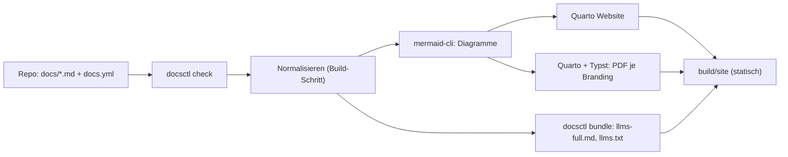

# Überblick

docsctl ist ein Werkzeug mit Regelwerk für technische Dokumentation, die im Repository neben dem Code
liegt. Menschen und Agenten schreiben Markdown in `docs/`, nach einer einzigen Konvention
([SPEC.md](https://github.com/servas-ai/docsctl/blob/main/SPEC.md) im Repository von docsctl). docsctl
prüft diese Quelle und baut daraus drei Ausgaben, ohne sie zu verändern: Web-Seiten mit Suche, je
Branding eine PDF im Stil einer technischen Abschlussarbeit und eine Gesamtfassung für Agenten.

## Pipeline

*Abbildung: Vom Markdown im Repository zu Web, PDF und Agentenfassung*

Branding ist reine Metainformation: ein Brand-Paket (`brands/<id>/`) liefert Farben, Schriften, Logo,
Deckblattvariante, Kopf- und Fußzeilen und Hinweistexte. Der Inhalt ist für alle Brands identisch,
ähnlich einer LaTeX-Dokumentklasse. Mitgeliefert ist das Branding `neutral`; eigene Brands liegen im
Projekt, das docsctl aufruft.

| Baustein | Version | Aufgabe |
|---|---|---|
| Quarto | 1.10.19 | Publishing-Schicht (Website, Typst-Format) |
| Typst | 0.15.1 | PDF-Satz (in Quarto enthalten) |
| mermaid-cli | 12.0.0 | Diagramme zu SVG (Web) und PDF (Druck) |
| Chromium | Debian trixie | Laufzeit für mermaid-cli |

*Tabelle: Gepinnte Bausteine im Builder-Image*

## Zwei Arten, docsctl zu nutzen

1. **Einzelnes Repository** (zum Beispiel bei einem Partner): `bin/docsctl build` im Repository mit
   `docs/` baut genau dieses Tool, Branding `neutral`. Siehe [Repository dokumentieren](30-how-to/neues-tool.md).
2. **Portal über viele Repositories**: ein eigenes Projekt mit `catalog.yml` sammelt mehrere Repositories
   ein, bringt eigene Brands und Betreiberangaben mit und stellt `build/site` hinter einen Login. Siehe
   [Portal aufsetzen](30-how-to/portal.md).

Wie ein Branding dazukommt, steht in [Neues Branding](30-how-to/neues-branding.md); alle Befehle in
[Befehle](50-reference/befehle.md).
