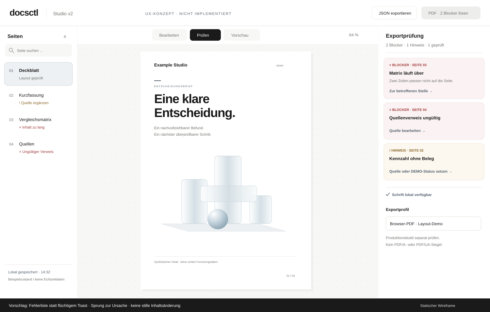

# Studio v2: UI/UX-Folgepakete

**05.11.2026 · Vorschlag, nicht implementiert.** Ergänzung zu PR #1, keine neue Runtime, keine geänderte SPEC und keine Produktionsfreigabe. Das Wireframe enthält ausschließlich synthetische, markenneutrale Inhalte.



## Ausgangspunkt und Designrichtung

Gelesene Basis: Commit `75780f415e426d5dac485cbeb3a8a816483bd706`, insbesondere [index.html](https://github.com/servas-ai/docsctl/blob/75780f415e426d5dac485cbeb3a8a816483bd706/studio-v2/index.html), [README](https://github.com/servas-ai/docsctl/blob/75780f415e426d5dac485cbeb3a8a816483bd706/studio-v2/README.md) und [Cover-Standard](https://github.com/servas-ai/docsctl/blob/75780f415e426d5dac485cbeb3a8a816483bd706/studio-v2/COVER-PROMPTS.md). Die folgenden Beobachtungen stammen aus dem Quellcode-Read, nicht aus einem neuen interaktiven Test der laufenden Demo.

Beibehalten: weiße Seiten, viel ruhige Fläche, große klare Titel, ein semantisches Glass-Motiv, dünne Linien, neutraler Akzent `#52606d`, Systemschrift-Fallback. Text bleibt getrennt vom Artwork. Keine Icon-Schienen auf dem Cover und keine dekorativen KPI-Zahlen ohne Quelle. Markenpakete und private Projektberichte bleiben außerhalb dieses öffentlichen Repositorys.

## Acht konkrete Verbesserungen

| ID / Priorität | Beobachtung und Nutzen | Kleinster sinnvoller Schritt | Abnahme |
|---|---|---|---|
| UX-01 / P0 | `validateLayout()` liefert Seitennummern; `printButton` zeigt einen Toast. Die Ursache ist nicht direkt erreichbar. | Dauerhaftes Prüfpanel mit `pageId`, `blockId`, Code, Schweregrad und lokalisiertem Hinweis; Sprung zur betroffenen Seite. | Überlauf auf einer nicht aktiven Seite wird gefunden; Enter öffnet die Ursache und setzt Fokus. Kein PDF-Start bei Blockern. Nach Bearbeitung verschwindet der Befund erst nach erneuter Prüfung. |
| UX-02 / P0 | README kennzeichnet Matrizen und KPIs als fest eingebaute Beispieldaten. Optische Bearbeitung ist noch kein Dateneditor. | Ein versionierter Tabellen-/KPI-Block mit typisierten Zellen, Einheit, Quelle und Evidenzstatus; zuerst eine Tabellenart. | Editieren → Speichern → Import → Export erhält Werte und Herkunft. Fehlend ist `null`, nicht 0. Ungültige Zahlen werden sichtbar abgelehnt. Keine stillen Beispielwerte in echten Reports. |
| UX-03 / P1 | KI-Vorschläge werden als JSON angezeigt; Freigabe und Stale-Prüfung existieren bereits. | Lesbarer Vorher/Nachher-Vergleich pro Textfeld mit Annehmen/Ablehnen je Änderung. Roh-JSON bleibt aufklappbar. | Fokus und Tastaturbedienung funktionieren; Änderung seit Vorschlag blockiert weiterhin jede Übernahme. Eine Annahme = ein Undo-Schritt. KI darf keine Quellen oder Prüfstatus ungeprüft aufwerten. |
| UX-04 / P1 | Seitenliste und Bibliothek sind vorhanden, jedoch ohne dokumentweiten Such-/Befundfilter. | Seiten nach Titel und Typ filtern; optional nur Seiten mit offenen Befunden. Aktive Seite und Trefferzahl sichtbar halten. | 60 Seiten bleiben erreichbar; kein Treffer ist ein eigener Leerzustand. Tastaturnavigation, Umordnung, Duplizieren und Undo erhalten stabile IDs. |
| UX-05 / P1 | Eine hübsche Kennzahl allein erklärt weder Zeitpunkt noch Prüfumfang. | Pro Datenblock ein kleiner Quellen-/Evidenzbereich: Quelle, Datum, Umfang, Status (`DEMO`, `HISTORISCH`, `GEPRÜFT`, `OFFEN`). | Status zusätzlich als Text/Symbol, nicht nur Farbe. Historische Werte werden nie als Livezustand exportiert. Fehlende Quellen erzeugen einen Hinweis, keine erfundene Referenz. |
| UX-06 / P1 | Fixed-page-Templates stoppen bei Überlauf; automatischer Reflow fehlt bewusst. | Explizites „Auf Folgeseite teilen“ mit Vorschau statt automatischer Schriftverkleinerung. Zuerst Absatzblöcke, danach Tabellen mit wiederholter Kopfzeile. | Keine verlorenen Absätze/Zeilen, Quellen bleiben zugeordnet, IDs bleiben eindeutig. Übernahme ist rückgängig machbar. Mindestschriftgröße und Footer-Abstand bleiben erhalten. |
| UX-07 / P2 | Zoom, Farbwahl und Blur sind vorhanden; Ressourcen können trotzdem unpassend sein. | „An Breite anpassen“, Doppelseitenansicht und Safe-Area-Overlay; Artwork-Fokuspunkt statt blindem Crop. Brand-/Font-/Bild-Provenienz aufklappbar. | Keine Bildschrift, keine automatische Asset-Beschaffung; Titelbereich bleibt frei. Fehlende lokale Schrift wird vor Export als Fallback gemeldet. Keine behauptete DPI ohne Pixel- und Ausgabegrößenprüfung. |
| UX-08 / P2 | Lokales Speichern funktioniert laut README; Fehler- und Wiederherstellungszustände verdienen eine eigene Oberfläche. | Sichtbare Zustände „ungespeichert / gespeichert / fehlgeschlagen“ plus bewusst abrufbarer lokaler Snapshot. | Speicherfehler überschreibt nicht die letzte gute Fassung; Import-Konflikt erfordert eine Entscheidung. Wiederherstellen bleibt lokal und ist rückgängig machbar. Keine heimliche Cloud-Synchronisierung. |

## Drei kleine Lieferpakete statt eines neuen Editors

**A — Prüfen und navigieren:** UX-01 + die Befundfilter aus UX-04. Der vorhandene Editor und `validateLayout()` bleiben Ausgangspunkt. Das Wireframe zeigt dieses Paket. Zuerst eine persistente Fehlerliste, Tastaturfokus und Export-Sperre; kein neues UI-Framework erforderlich.

**B — Daten und Herkunft:** UX-02 + UX-05 für eine einzige Tabellenart. Schema-Migration, Renderer, Validator, JSON-Roundtrip und V1-Content-Export zusammen liefern. Die übrigen Demoblöcke bleiben ausdrücklich DEMO. Layouttreue des V1-Exports wird nicht vorgetäuscht.

**C — Verstehen und korrigieren:** UX-03, danach UX-06. Vorhandene Stale-Sperre und Undo-Historie erhalten. Das Modell schlägt vor, der Mensch entscheidet; keine automatische Änderung mehrerer Seiten ohne sichtbaren Diff.

## Kleine Schnittstelle für das Prüfpanel

Vorschlag für Daten, kein bereits implementiertes API:

```json
{
  "pageId": "demo-page-03",
  "blockId": "demo-matrix-01",
  "severity": "blocker",
  "code": "layout.overflow",
  "message": "Zwei Zeilen passen nicht auf die Seite.",
  "action": "focus-block"
}
```

Prüfergebnisse sind abgeleiteter Zustand und werden nach relevanten Änderungen neu berechnet. Nicht lokalisierte Fehlercodes bleiben stabil; UI-Texte sind austauschbar. Exportblocker, Quellenhinweise und erfolgreiche Layoutprüfungen werden getrennt gezählt. Ein fehlerfreies Layout bedeutet keine fachliche, rechtliche oder technische Freigabe des Inhalts.

## Test- und Sicherheitsgrenzen

Für die spätere Umsetzung: Desktop 1440 × 900 und 1920 × 1080, mobile Breite 390 px, vollständige Tastaturbedienung, sichtbarer Fokus, gespeicherter Import-/Export-Roundtrip und PDF-Text-/Link-/Überlaufprüfung. Künstliche Überläufe, fehlende Quellen, lokale Speicherfehler und veraltete KI-Vorschläge sind Pflicht-Negativfälle.

Dieses Dokument und die SVG wurden als statische Artefakte geprüft. Die vorgeschlagenen Interaktionen, echter Puck-Host, Live-Modellinferenz, native Mermaid-Runtime, Typst-Produktionsbuild, `make check` und PDF/UA-Abnahme wurden für diesen Dokumentationsnachtrag **nicht ausgeführt**. Die früheren 132 Prüfungen aus der PR-Beschreibung sind historische Nachweise des ursprünglichen Funktionsstands, keine Tests dieser Vorschläge.

Keine Änderung von Server-Bindung, Host/Origin/CSRF-Prüfung, erlaubten Modellzielen, HTML-Sanitizing, Dateibudgets oder Rechteumfang. Keine neuen Dependencies, keine externen Assets, keine Kundendaten, kein Deployment und kein Merge. Erst prüfen, dann einen der drei kleinen Slices umsetzen.
